<p align="center">
  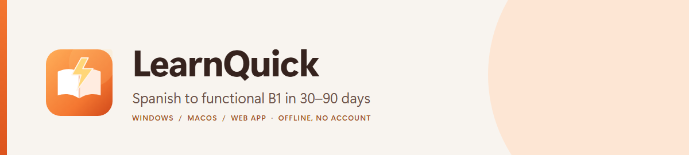
</p>

# LearnQuick: learn Spanish to B1, free and offline

**LearnQuick is a free app for Windows and Mac that takes English speakers to conversational Spanish (level B1) with a personal plan of 30, 60 or 90 study days.** It works without the internet, asks for no account and has no ads.

**[Download](#download)** · [What you get](#what-you-get) · [See it](#see-it) · [How you learn](#how-you-learn) · [Questions](#questions) · [For developers](#for-developers)

## Download

**Latest version: 1.4.6.** It is free, and you do not need a GitHub account.

| | Windows 10 or 11 | Mac (macOS 14.4 or later, Apple Silicon or Intel) |
| --- | --- | --- |
| **1. Download** | [**LearnQuick for Windows**](https://github.com/Fredplusplus10/learnquickES/releases/latest/download/LearnQuick-windows.zip) | [**LearnQuick for Mac**](https://github.com/Fredplusplus10/learnquickES/releases/latest/download/LearnQuick-macos.zip) |
| **2. Unpack** | Right-click the downloaded zip → **Extract All…** | Double-click the downloaded zip, open **LearnQuick.dmg** and drag **LearnQuick** onto **Applications** |
| **3. Open** | In the extracted folder, open **bin** and double-click **LearnQuick.exe** | Open **LearnQuick** from Applications |
| **4. The first time** | A blue window says *Windows protected your PC*: click **More info → Run anyway** | macOS says it *could not verify "LearnQuick"*: click **Done**, open **System Settings → Privacy & Security**, scroll down and click **Open Anyway** |

The warning in step 4 appears because LearnQuick is not signed with a paid certificate yet, not because anything harmful was found. The download is about 300 MB. Every step in detail, and what to do if something does not work: [Installing LearnQuick](docs/INSTALL.md).

### Getting a new version

LearnQuick never connects to the internet, so **it cannot update itself or tell you that a new version exists**. To stay up to date:

- **About every 15 days**, open **Settings → Updates** in the app. It shows the version you have, and **Download latest version** opens this project's download page. If the version there is newer than yours, download it and install it as above; your progress carries over.
- Or come back to this page: the latest version is always named at the top of this section, and the two links above always download it.
- If you have a GitHub account, **Watch → Custom → Releases** at the top of this page sends you an email for each new version.

## What you get

- **A plan made for you.** A short welcome asks your name, your level and why you are learning. You get a plan of 30, 60 or 90 study days, Monday to Friday by default, that skips weekends, holidays and the days off you choose.
- **25 lessons in 5 phases,** with 300 words, 230 exercises, dialogues and one grammar shortcut per lesson.
- **A Spanish voice inside the app.** It reads every word and dialogue at a pace for learners, with a voice for each character, and works offline. You pick your own voice out of six.
- **Review at the right moment.** The words you learn come back after 1, 2, 4, 8, 16, 32 and 60 days, and the ones you miss come back sooner.
- **Trainers for what is hard:** verbs, *fui* or *iba*, noun gender, false friends, words English and Spanish share, and describing things when you lack the word.
- **A streak that is fair.** A few minutes keep the day. Weekends, holidays and days off never break it, and you have two freezes for the days life gets in the way.
- **Spanish outside the app counts too.** Log the podcasts and series you listen to, and on the desktop app bring in what you watched on Netflix.
- **Checkpoints and a B1 mock exam** modelled on the DELE B1 and, on the desktop app, a certificate when you are ready for the next level. The certificate is LearnQuick's own, not an official qualification.
- **Your progress stays on your computer,** and one backup file moves it to another computer whenever you want.

The 30–90-day range is a **study-plan duration, not a guarantee of fluency**. From a solid A2 base, the plan targets functional conversational B1; from zero, a solid A2 is the realistic outcome in 90 days. The reasoning and sources are in [docs/INVESTIGACION-Y-METODO.md](docs/INVESTIGACION-Y-METODO.md) (Spanish).

## See it

### Desktop app on Windows

| Today | Lesson |
| :---: | :---: |
| 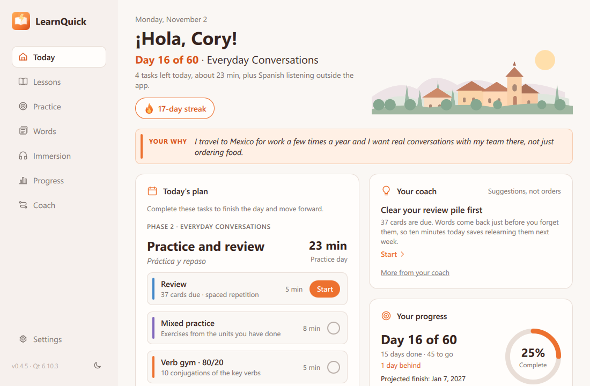 | 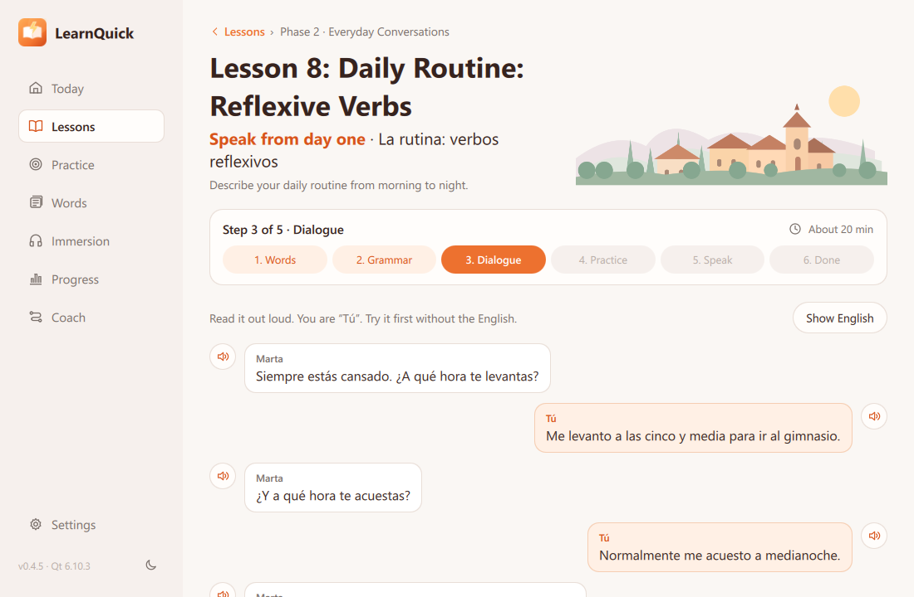 |
| **Practice** | **Progress** |
| 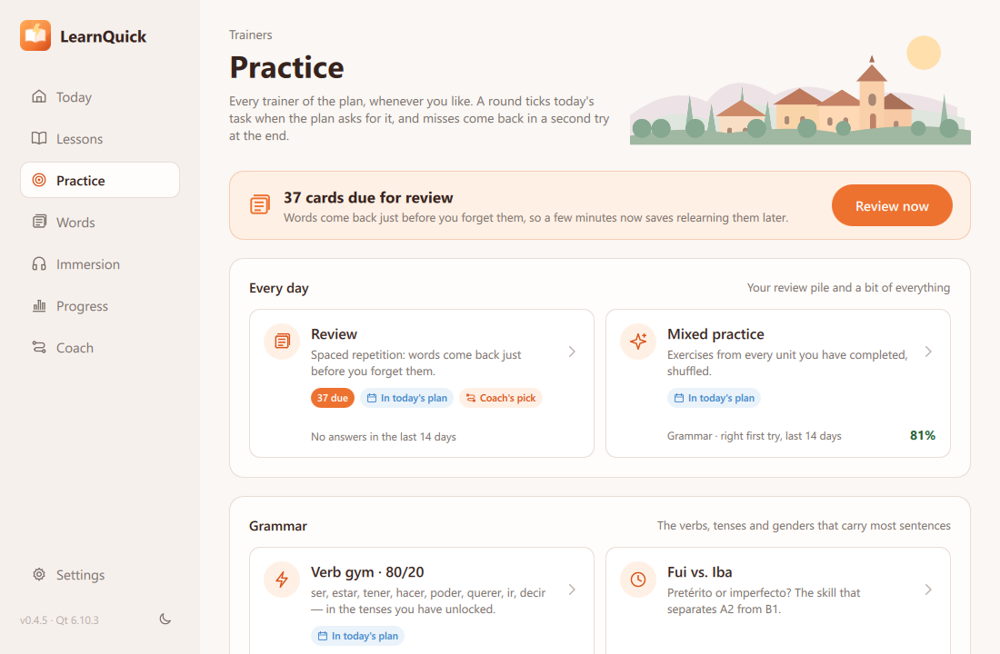 | 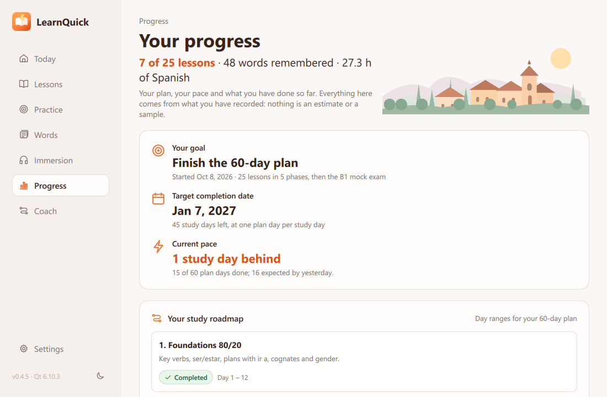 |

*Windows 11, LearnQuick 0.4.5, light theme. Real screenshots of the desktop app with its built-in sample learner (`--demo --today 2026-11-02`); the values are demo data, not measured learning results.*

<details>
<summary>Desktop app on macOS</summary>

| Today | Lesson |
| :---: | :---: |
| 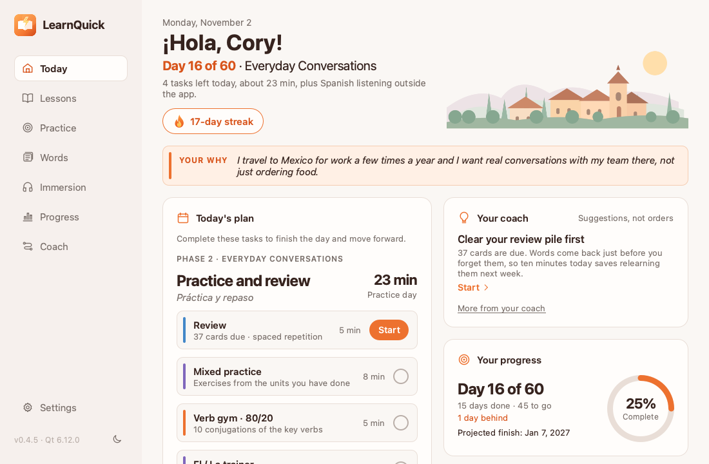 | 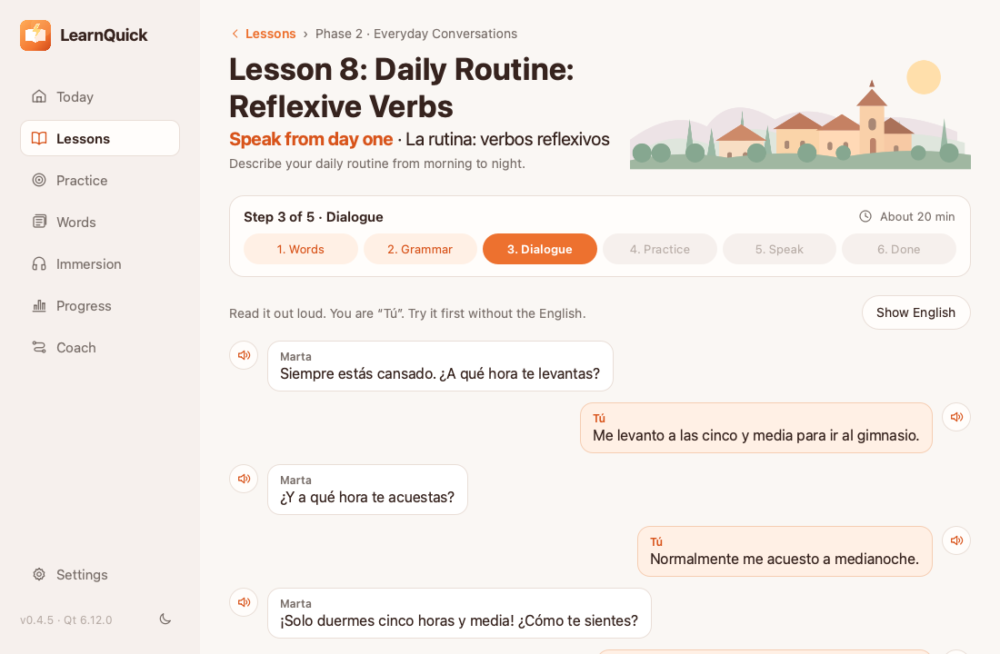 |
| **Practice** | **Progress** |
| 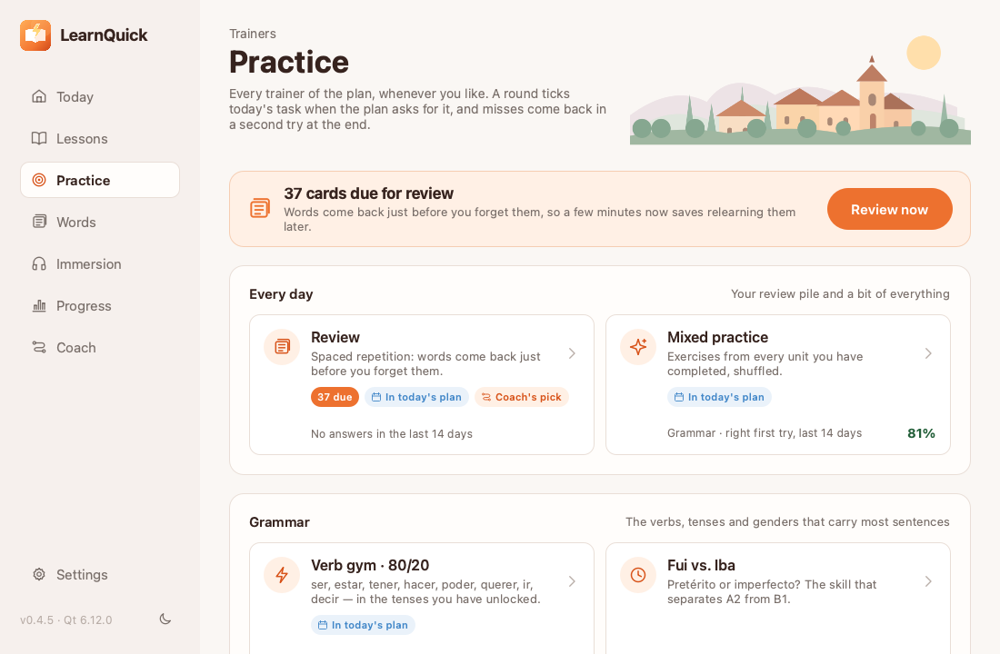 | 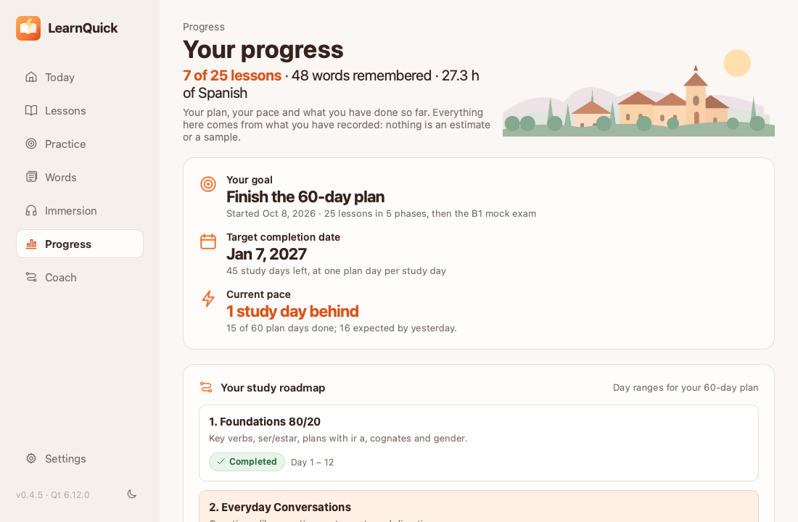 |

*macOS 26 Tahoe, LearnQuick 0.4.5, light theme, taken by the build workflow with the same sample learner and the same demo data.*

</details>

<details>
<summary>Web app</summary>

| Dashboard | Lesson |
| :---: | :---: |
| 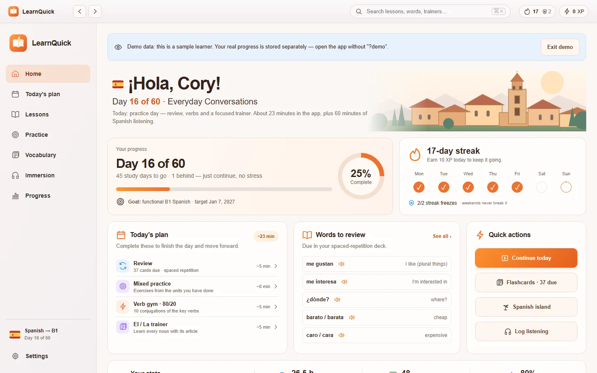 | 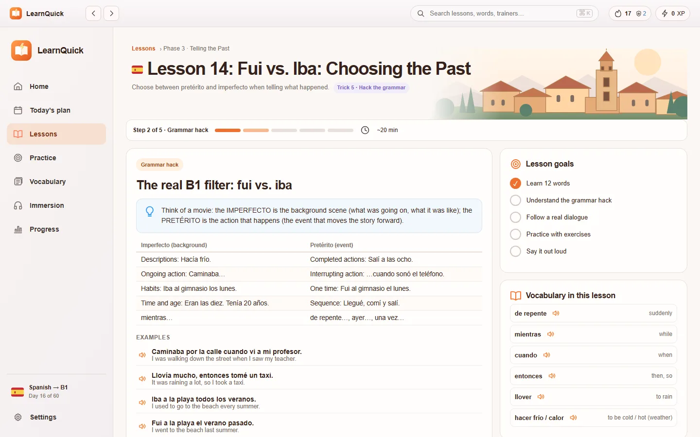 |
| **Practice** | **Progress** |
| 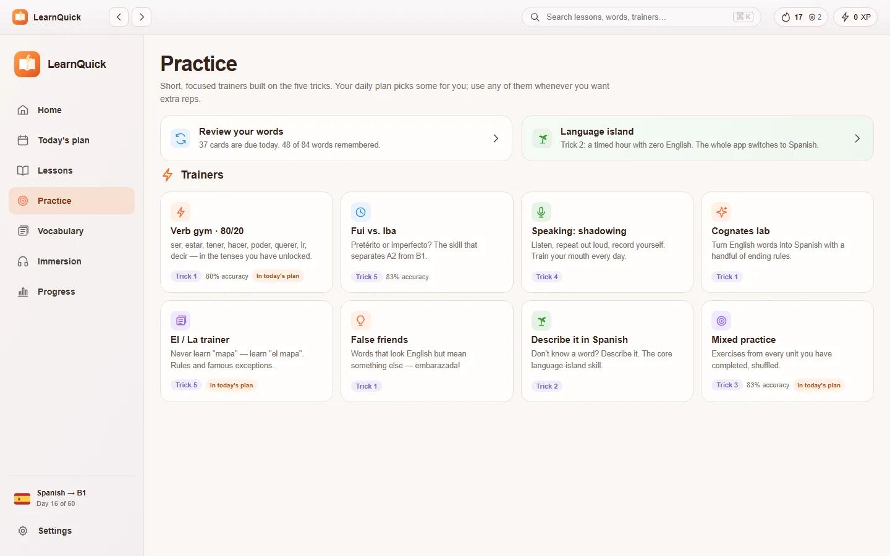 | 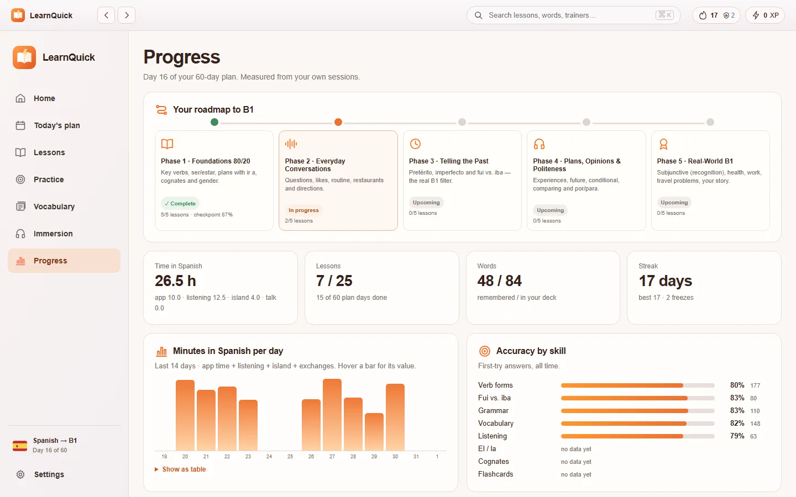 |

*Real screenshots of the web app with its sample learner (`?demo`), captured in headless Chrome.*

</details>

## How you learn

Each day combines a short session in the app (review, a lesson or a trainer, speaking out loud) with Spanish outside it (podcasts, series, conversation). The app tracks both. It is built on five practical "tricks", each tied to something you do in the app:

| Trick | Where it lives in the app |
| --- | --- |
| 1. 80/20 — the most frequent verbs (ser, estar, tener, hacer, poder, querer, ir, decir) and cognates | Phase 1, verb gym, cognates lab, false friends |
| 2. Goodbye English — device language and a daily “language island” | Device missions, one-hour island timer (whole UI in Spanish), describe-it trainer |
| 3. Comprehensible input at A2–B1 | Listening log and targets, hour milestones, curated resources, Spanish-subtitle guidance |
| 4. Speak from day one | Speaking step in every lesson, shadowing and pronunciation gym, language exchanges |
| 5. Hack the grammar — fui vs. iba, nouns with their article, subjunctive for recognition only | Preterite/imperfect trainer, gender trainer, a “Hack” box in every lesson |

More for learners: the [student guide](docs/STUDENT-GUIDE.md) and [how to count the Spanish you watch on Netflix](docs/NETFLIX-GUIDE.md).

## Questions

**Is it really free?** Yes. There are no ads, no account, no subscription and nothing to buy inside the app.

**Does it need the internet?** Only to download it. After that it works offline and never connects: nothing you do in the app leaves your computer.

**Why do Windows and macOS warn me when I open it?** Because LearnQuick is not signed with a paid developer certificate yet. The warning is about the missing signature, not about anything harmful found. Step 4 of [Download](#download) gets you past it, and [Installing LearnQuick](docs/INSTALL.md) covers the other messages you may see, such as macOS saying the app *is damaged*.

**Will I lose my progress when I install a new version?** No. The desktop app keeps your progress in a folder of its own, apart from the app, so replacing the app leaves it as it was. To be safe, or to move to another computer, use **Settings → Save a backup…**. [Where your data is kept](docs/INSTALL.md#your-data).

**How do I know there is a new version?** The app cannot tell you, because it never connects. Check about every 15 days: see [Getting a new version](#getting-a-new-version).

**Which Spanish does it teach?** Latin American Spanish. *Vosotros*, which is only used in Spain, is left out by default.

**Is the certificate official?** No. It is LearnQuick's own record that you passed its level assessment. It is not a CEFR or DELE qualification.

**I do not have Windows or a Mac. Can I still use it?** Yes, in a browser: see [the web version](#the-web-version).

**Something does not work, or I have an idea.** Open an [issue](https://github.com/Fredplusplus10/learnquickES/issues) and say what you did and what you saw.

## The web version

LearnQuick also runs in a browser, with nothing to install. It has the same lessons and trainers. The built-in voice and the Netflix import are in the desktop app only: in the browser, LearnQuick speaks with the Spanish voices your system has.

1. At the top of this page, click **Code → Download ZIP** and extract it.
2. Double-click **`LearnQuick.html`**.

Your progress is saved in that browser, on that computer. Use **Settings → Download backup** every week or so, and before you replace the folder with a newer one. To look around first, click *Explore a demo* on the welcome screen: the demo never touches real progress.

---

## For developers

> **Current status: a desktop app for Windows and macOS (downloads above) and a web app (v1.0).** The web app is a dependency-free HTML/CSS/JavaScript application that runs from a double-click, with no server, account or network connection. The native desktop app is built in C++20 + Qt 6 in [`desktop/`](desktop/README.md). It is at phase 4 of 5: the whole daily plan runs natively (lessons, spaced-repetition review, the eight trainers, phase checkpoints and the B1 mock), with progress in SQLite, a built-in neural Spanish voice, a guiding coach that asks every few sessions what the learner enjoyed, and screens for words, immersion and progress with achievements, built for Windows and macOS in CI (see [roadmap](docs/ROADMAP.md)).

### Feature status

| Capability | Status | Notes |
| --- | --- | --- |
| Study plan of 30 / 60 / 90 study days | Implemented | Mon–Fri by default; weekends, US federal holidays and custom days off are excluded. Pace and target date are recalculated from completed days |
| Placement test and plan recommendation | Implemented | 15 questions → A1 / A2 / A2+ and a suggested plan length |
| Curriculum | Implemented | 25 lessons in 5 phases; 300 vocabulary items with articles; 230 exercises; dialogues; grammar “hacks” |
| Streak | Implemented | 10 XP keeps the day; up to 2 freezes; non-study days never break it; the daily goal is separate from the streak |
| Trainers | Implemented | Verb conjugation (25 verbs, tenses unlock with lessons), preterite vs. imperfect, cognates, false friends, noun gender, describe-it, mixed practice |
| Spaced repetition | Implemented | Leitner boxes (0, 1, 2, 4, 8, 16, 32, 60 days); accent-only mistakes count as “almost” |
| Immersion tracking | Implemented | Listening log with daily target, hour milestones, curated A2–B1 resources, device-language missions, language exchanges, timed “language island” that switches the UI to Spanish |
| Checkpoints and B1 mock exam | Implemented | 15-question checkpoint per phase; final mock modelled on DELE B1 (writing and speaking partly self-assessed) |
| Spanish text-to-speech | Browser-dependent | `SpeechSynthesis` with installed macOS voices; Mexican Spanish by default, configurable |
| Built-in neural voice | Implemented (native app) | A natural Spanish voice (Supertonic 2) that ships with the app and works offline, the same on Windows and Mac, at a pace for learners, with a voice for each dialogue character; the learner picks their own voice (six) and its normal and slow speed in Settings; "a / b" is read "a o b" and "305" "trescientos cinco" |
| Recording | Browser-dependent | Shown only when the browser allows it; no pronunciation score is ever invented. “Listen & repeat” works everywhere |
| Speech recognition (“Check words”) | Coming soon | Shown as coming soon. It will run on the device only, once the app can offer the browser's Spanish language pack |
| Persistence | Implemented (browser) | `localStorage` with versioned schema, weekly backup reminder, JSON export/import |
| Calendar reminder | Implemented | Downloads a repeating `.ics` event for the study days |
| Native app for macOS and Windows | Released | C++20 + Qt 6 in [`desktop/`](desktop/README.md). Each version tag builds an unsigned universal `.dmg` (not notarized) and a Windows folder with the `.exe`, and prepares the release that carries them |
| SQLite persistence | Implemented (native app) | Profile, full progress and settings in a local SQLite file with versioned migrations; backups in the web app's format, so either app restores the other's |
| Day and night mode | Implemented (native app) | Follows the computer by default; Settings or the sun / moon button switches it |

### Run the web app from the source

No frameworks, package manager, build step, external APIs or network services are required.

- **Open it:** double-click [`LearnQuick.html`](LearnQuick.html). It opens `app/index.html` in the default browser.
- **Demo data:** open `app/index.html?demo` (or click *Explore a demo* on the welcome screen). The demo uses separate storage and never touches real progress.
- **Optional local server** (lets Chrome use the microphone, which it blocks on `file://`):

  ```bash
  python3 -m http.server 8765
  ```

  Then open `http://localhost:8765/app/`. Browser storage is per origin, so progress saved under `file://` and under `localhost` is separate; move it with *Settings → Download backup / Restore*.

### Architecture

```text
LearnQuick.html  ──►  app/index.html  (design-kit shell, classic <script> tags)
                          │
                          ├── js/core/      pure logic: calendar, streak, SRS, verbs, progress, store
                          ├── js/content/   lessons, trainers, resources, mock exam (plain JS data)
                          ├── js/ui/        components, speech, exercise session engine
                          ├── js/views/     one module per screen (hash routing)
                          └── js/app.js     router, delegated events, top bar, ⌘K search, activity timer
                          │
                          ▼
                    localStorage (versioned state) + JSON backups
```

Classic scripts are used instead of ES modules and `fetch` because browsers block both on `file://`. The same files load in Node for the tests. Details: [architecture](docs/ARCHITECTURE.md) and [data model](docs/DATA_MODEL.md).

The native app is **C++20 + Qt 6**: QML describes the screens and C++ holds all the logic. It adds SQLite, and later on-device speech recognition (whisper.cpp) and conversation practice (llama.cpp). It is developed on Windows, and CI builds a universal macOS binary that runs on Apple Silicon and Intel. The web app's content and tests are its specification. Build instructions and phases: [`desktop/README.md`](desktop/README.md).

### Repository structure

```text
.
├── README.md
├── LearnQuick.html        # Launcher: double-click to open the app
├── app/                   # The application (HTML/CSS/JS, no dependencies)
│   ├── index.html
│   ├── css/               # kit.css (design system) + app.css (application layer)
│   ├── js/                # core / content / ui / views / app.js
│   └── assets/            # Icons, illustrations, logos, app icons
├── tests/                 # node:test suites for the learning engine and content
├── assets/
│   ├── brand/             # Scalable visual identity and application icon
│   ├── preview/           # GitHub social preview and README header
│   └── screenshots/       # Real screenshots of the web and desktop apps
├── content/lessons/       # Example structured lesson content (future JSON format)
├── desktop/               # Native app: C++20 + Qt 6 (CMake, QML, platform icons)
├── docs/                  # Architecture, method, guides, roadmap and policies
├── scripts/               # Static repository validation and release notes
└── .github/               # CI, issue and pull request templates
```

### Documentation

- [Student guide](docs/STUDENT-GUIDE.md) (English)
- [Installing LearnQuick](docs/INSTALL.md) (English)
- [Count the Spanish you watch on Netflix](docs/NETFLIX-GUIDE.md) (English, desktop app, Windows and Mac)
- [Research, conclusions and method](docs/INVESTIGACION-Y-METODO.md) (Spanish)
- [Developer guide](docs/DESARROLLO.md) (Spanish)
- [Architecture and component boundaries](docs/ARCHITECTURE.md)
- [Content and persistence model](docs/DATA_MODEL.md)
- [UI design system and brand rules](docs/DESIGN_SYSTEM.md)
- [Implementation status and limitations](docs/STATUS.md)
- [Development roadmap](docs/ROADMAP.md)
- [Native desktop app: build and phases](desktop/README.md) (Spanish)
- [Brand asset inventory](docs/ASSET_GUIDELINES.md)
- [Dependency review for the latest release](docs/DEPENDENCY_REVIEW.md)

### Quality checks

```bash
python3 scripts/validate_repository.py
node --test tests/core.test.js tests/content.test.js tests/audit-regressions.test.js
```

The validation script checks SVG files, required repository artifacts, local HTML/CSS asset references and Markdown relative links. The test suites cover calendar and holiday rules, streak and freeze logic, spaced repetition, answer checking, every verb × tense form, a full simulated 30-day plan and the integrity of all 25 lessons. GitHub Actions runs both on every push, plus a JavaScript syntax check.

For the native app, a second workflow runs for each version tag (`v*`), or when started by hand:
- it builds on Windows and macOS;
- it runs a headless smoke test, which fails on any QML warning, on both the build and the deployed app;
- it keeps the Windows build and a universal `.dmg` as downloadable artifacts;
- for a version tag, it creates a draft release with `LearnQuick-windows.zip`, `LearnQuick-macos.zip` and `SHA256SUMS.txt`.

## Privacy

Neither app includes external fonts, SDKs, analytics or telemetry, and neither makes a network request. Progress stays on the learner's computer: in one file in the desktop app, and in the browser's local storage in the web app. Both can save it as a backup file. Links to external resources (podcasts, Tandem, HelloTalk) and to the downloads open in the browser, only when the learner clicks them. Recordings are played back from memory and never leave the device. Speech recognition is not offered yet; when it is, the app will ask the browser to run it on the device only. More: [security policy](SECURITY.md).

## License

- **Code:** the MIT License ([LICENSE](LICENSE)).
- **Graphic assets: all rights reserved.** The MIT License does not cover the illustrations, logos, app icons, interface icons and certificate designs. You may not reuse them outside LearnQuick without permission. They are:
  - `assets/brand/` and `assets/preview/`;
  - `app/assets/illustrations/`, `app/assets/logos/`, `app/assets/app-icons/` and `app/assets/icons/`;
  - `desktop/images/`, `desktop/assets/illustrations/` and the app icons in `desktop/platform/`;
  - the certificate designs (`desktop/assets/certificates/`: `certificate_*.svg` and their level badges).
- **Third-party software** in the desktop app (Qt, FFmpeg, ONNX Runtime, the Supertonic 2 voice and others) keeps its own licenses: see [THIRD_PARTY_NOTICES.md](THIRD_PARTY_NOTICES.md). The built-in voice is under the BigScience Open RAIL-M License, whose use restrictions apply to anyone using it through LearnQuick.

More detail: [licensing notes](docs/LICENSING.md).

## Contributing

Review [CONTRIBUTING.md](CONTRIBUTING.md) before proposing changes.
